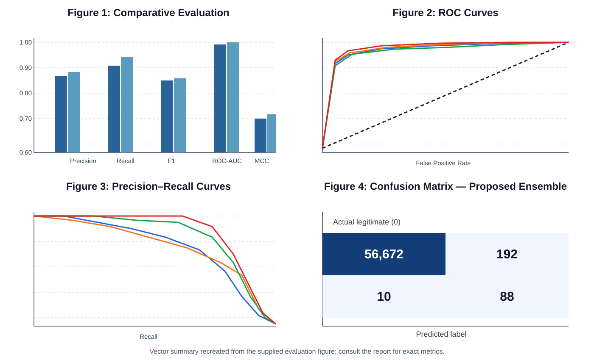

# Credit Card Fraud Detection

A machine-learning project for identifying potentially fraudulent credit-card transactions. It combines imbalanced-data training, model comparison, threshold selection, evaluation metrics, and a Streamlit interface for single-transaction and batch predictions.

> **Project status:** The repository includes the code, automated tests, and evaluation workflow. The chart below is the project-provided evaluation visualization. Re-run experiments with documented data and split settings before treating the displayed metrics as independently reproduced results or making production-performance claims.

## Contents

- [Problem statement](#problem-statement)
- [Dataset](#dataset)
- [Approach](#approach)
- [Evaluation results](#evaluation-results)
- [Understanding the confusion matrix](#understanding-the-confusion-matrix)
- [Repository structure](#repository-structure)
- [Setup](#setup)
- [Train the ensemble](#train-the-ensemble)
- [Compare models](#compare-models)
- [Run the Streamlit application](#run-the-streamlit-application)
- [Run tests](#run-tests)
- [Limitations and next steps](#limitations-and-next-steps)
- [References](#references)

## Problem statement

Credit-card fraud detection is a binary classification problem:

- **Legitimate transaction (\`Class = 0\`)** — a transaction not labelled as fraud.
- **Fraudulent transaction (\`Class = 1\`)** — a transaction labelled as fraud.

Fraud is rare compared with legitimate activity. A classifier can therefore achieve high overall accuracy by predicting almost every transaction as legitimate while still failing to detect fraud. This project emphasizes metrics that expose this trade-off, especially **recall, precision, area under the precision–recall curve (AUPRC), ROC-AUC, and false-positive/false-negative counts**.

## Dataset

This project is designed for the public [MLG-ULB Credit Card Fraud Detection dataset on Kaggle](https://www.kaggle.com/datasets/mlg-ulb/creditcardfraud).

- Documented size: 284,807 transactions and 31 columns.
- Target: \`Class\`, where 0 is legitimate and 1 is fraud.
- Features: \`V1\`–\`V28\`, \`Time\`, \`Amount\`, and \`Class\`.
- \`V1\`–\`V28\` are anonymized numerical features produced using PCA; their original feature meanings are not provided.
- \`Time\` records elapsed seconds relative to the first transaction in the dataset.
- \`Amount\` is the transaction amount.

The documented dataset contains 492 fraud cases (about 0.173% of all transactions), so class imbalance is substantial. The training code drops \`Time\` and uses \`V1\`–\`V28\` and \`Amount\` as model features.

### Obtain the data

Download the CSV from Kaggle and place it locally. The file is commonly named \`creditcard.csv\`.

**Do not commit the dataset CSV or trained model artifacts to GitHub.** Keep the large dataset on your machine and link to the Kaggle source instead.

## Approach

1. **Validate and prepare the data.** Check expected columns, numeric and finite values, and binary target labels.
2. **Split the data.** The main training pipeline creates training, validation, and held-out test partitions with stratification.
3. **Scale the amount.** Fit a \`StandardScaler\` on the training partition only and reuse it for validation, test, and inference.
4. **Handle class imbalance.** Apply SMOTE to the training partition only. Validation and test partitions retain the original class distribution.
5. **Train classifiers.** The main pipeline uses a soft-voting ensemble of Random Forest, LightGBM, and XGBoost. A separate script compares these models with Logistic Regression.
6. **Choose a threshold.** Select a decision threshold using validation probabilities, rather than tuning it on the held-out test set.
7. **Evaluate.** Report precision, recall, ROC-AUC, AUPRC, Matthews correlation coefficient (MCC), and confusion-matrix counts.
8. **Serve predictions.** Use the Streamlit application for one transaction or a batch CSV file.

### Why use a decision threshold?

A model estimates a fraud probability. A threshold converts that probability into a class prediction. Lowering the threshold usually catches more fraud but may increase false alarms; raising it may reduce false alarms but miss more fraud. The threshold should reflect the cost of missed fraud, the cost of investigating legitimate transactions, and operational capacity. Maximizing F1 is a useful baseline, not a universal business optimum.

## Evaluation results

The figure below is a vector summary recreated from the supplied project evaluation image. It illustrates model-score comparisons, ROC curves, precision–recall curves, and the proposed ensemble's confusion matrix. The vector chart is illustrative; use the original experiment output for exact curves and model scores.

### Reading the charts

- **Figure 1 — Metric comparison:** Compares displayed scores for Random Forest, LightGBM, XGBoost, and the proposed ensemble. Precision, recall, F1, ROC-AUC, and MCC measure different properties and are not interchangeable.
- **Figure 2 — ROC curves:** Shows the true-positive rate against the false-positive rate at different thresholds. The diagonal represents random ranking; curves closer to the top-left generally indicate stronger discrimination. ROC-AUC summarizes ranking performance across thresholds.
- **Figure 3 — Precision–recall curves:** Shows the trade-off between precision and recall. This is especially informative for a dataset with very few fraud cases. The chart labels the proposed ensemble's AUPRC as 0.8465.
- **Figure 4 — Confusion matrix:** Shows counts for legitimate and fraudulent transactions at the chosen threshold.

### Confusion matrix shown in the supplied figure

| Actual class | Predicted legitimate | Predicted fraud |
|---|---:|---:|
| Legitimate (0) | 56,672 (true negatives) | 192 (false positives) |
| Fraud (1) | 10 (false negatives) | 88 (true positives) |

Based on these displayed counts:

- **Recall:** 88 / (88 + 10) = approximately **89.8%**. The model identified 88 of the 98 fraud cases in this test set.
- **Precision:** 88 / (88 + 192) = approximately **31.4%**. Of the 280 transactions flagged as fraud, 88 were labelled fraud in the dataset.
- **False-positive rate among legitimate transactions:** 192 / (56,672 + 192) = approximately **0.34%**.

These figures illustrate a practical trade-off: the displayed threshold catches most fraud cases but generates false alerts that may require review. The best threshold depends on the intended use case.

**Reproducibility note:** The chart is included as supplied project material. Its evaluation split, random seed, model versions, and threshold-selection procedure should be recorded alongside the experiment. The metrics above are calculated from the confusion matrix shown in the image; they are not a guarantee of future performance. Regenerate the chart from the current code and dataset before presenting it as a final benchmark.

## Repository structure

\`\`\`text
credit-card-fraud-detection/
├── app.py                    # Streamlit single-transaction and batch UI
├── fraud_detection.py        # Feature preparation, training, evaluation, artifacts
├── train_model.py            # Train ensemble and write evaluation_report.json
├── compare_models.py         # Compare baseline models and voting ensemble
├── requirements.txt          # Python dependencies
├── tests/                    # Automated regression and smoke tests
├── docs/
│   └── model-evaluation.png  # Evaluation figure used in this README
└── DATASET_EVALUATION.md     # Dataset evaluation workflow and notes
\`\`\`

## Setup

Use a supported Python 3 version (Python 3.11 is used by the repository's CI workflow).

1. Install Python from [python.org](https://www.python.org/downloads/) if it is not installed. On Windows, select the option to add Python to PATH if it appears.
2. Open a terminal in the repository folder.
3. Install dependencies:

\`\`\`bash
python -m pip install -r requirements.txt
\`\`\`

If \`python\` is not recognized on Windows, reopen the terminal after installation. Depending on the installation, \`py -m pip ...\` may also work.

## Train the ensemble

With \`creditcard.csv\` in the repository folder, run:

\`\`\`bash
python train_model.py --data-path creditcard.csv
\`\`\`

The script saves these files by default:

- \`ensemble_model.joblib\` — trained ensemble model.
- \`scaler.joblib\` — scaler fitted to the training partition.
- \`threshold.joblib\` — validation-selected decision threshold.
- \`evaluation_report.json\` — dataset summary, threshold, and held-out test metrics.

You can override output paths, for example:

\`\`\`bash
python train_model.py --data-path data/creditcard.csv --report-path reports/evaluation_report.json
\`\`\`

Keep generated artifacts local unless you have a specific, appropriate reason to publish them. Model files may be large and are tied to the training data and package versions.

## Compare models

Run the comparison script to train Logistic Regression, Random Forest, LightGBM, XGBoost, and the soft-voting ensemble on shared data partitions:

\`\`\`bash
python compare_models.py --data-path creditcard.csv
\`\`\`

It prints precision, recall, F1, AUPRC, ROC-AUC, false positives, and false negatives, and writes \`model_comparison.json\`. The decision threshold is selected on validation data, while metrics are reported on a held-out random test split.

A high AUPRC or ROC-AUC alone does not choose the final model. Compare missed fraud cases and false alerts as well, and evaluate a chronological split before making deployment claims.

## Run the Streamlit application

After training the model artifacts, run:

\`\`\`bash
streamlit run app.py
\`\`\`

The application supports:

- **Single transaction:** enter feature values and get a predicted class and fraud probability.
- **Batch CSV:** upload multiple transactions, view predictions, and download the result CSV.
- **Configurable decision threshold:** adjust the threshold and observe how predictions change.

Batch input should contain \`V1\`–\`V28\` and either raw \`Amount\` or an already standardized \`scaled_amount\`. If raw \`Amount\` is supplied, the saved training scaler is used. An already standardized amount is not scaled a second time. Follow the input requirements shown in the application.

Artifact paths can be configured with environment variables:

- \`FRAUD_MODEL_PATH\`
- \`FRAUD_SCALER_PATH\`
- \`FRAUD_THRESHOLD_PATH\`

## Run tests

Install dependencies first, then run:

\`\`\`bash
python -m pytest -q
\`\`\`

The tests cover data preparation and validation, threshold handling, training/inference behavior on synthetic data, artifact loading, and a Streamlit UI smoke test. Synthetic tests help verify software behavior; they do not establish real-world fraud-detection performance.

## Limitations and next steps

- **Anonymized features:** The meanings of \`V1\`–\`V28\` are not available, limiting feature-level explanation.
- **Severe class imbalance:** Precision can be low even when recall and ROC-AUC look strong.
- **Short time span:** The dataset covers roughly two days. A random split may not represent future transaction streams.
- **Temporal validation:** Evaluate on later transactions than those used for training to test for time-related distribution changes.
- **Threshold choice:** Select it based on the business costs of false negatives and false positives, not only F1.
- **Calibration and drift:** Check probability calibration and monitor performance as transaction patterns change.
- **Operational controls:** A real payment system would need secure data handling, latency/reliability testing, monitoring, human review, and a documented response process.

This is an educational machine-learning project, not a certified fraud-prevention service. Do not use it to make real financial decisions without rigorous independent validation and appropriate controls.

## References

1. [Kaggle — Credit Card Fraud Detection (MLG-ULB)](https://www.kaggle.com/datasets/mlg-ulb/creditcardfraud)
2. [imbalanced-learn — SMOTE documentation](https://imbalanced-learn.org/stable/references/generated/imblearn.over_sampling.SMOTE.html)
3. [scikit-learn — Classification metrics](https://scikit-learn.org/stable/modules/model_evaluation.html)
4. [Streamlit documentation](https://docs.streamlit.io/)
