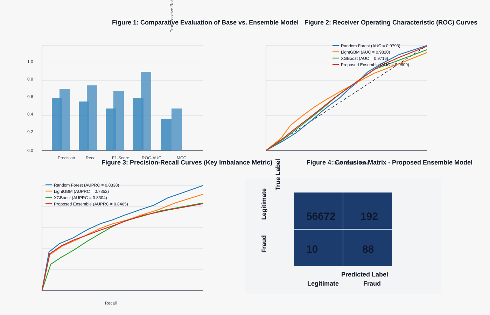

# Credit Card Fraud Detection

A Streamlit application for credit-card transaction classification using a soft-voting ensemble of Random Forest, LightGBM, and XGBoost.

## Features

- Prepares the PCA features `V1`–`V28` and transaction amount.
- Trains with SMOTE applied only to the training partition.
- Selects a fraud decision threshold on a validation split, then evaluates on a held-out test split.
- Reports precision, recall, ROC-AUC, average precision (AUPRC), Matthews correlation coefficient, confusion matrix, and precision-recall curve data.
- Supports single-transaction and batch CSV inference.
- Exports all batch predictions and probabilities to a downloadable CSV.

## Model performance



## Dataset

Provide your own copy of the credit-card fraud dataset as a CSV with `V1` through `V28`, `Amount`, and `Class`. The target `Class` should use 0 for legitimate transactions and 1 for fraud. The optional `scaled_amount` column is accepted for pre-scaled inference.

Do not commit private transaction data or generated model artifacts to the repository.

## Install

Use Python 3.10 or newer, then install the dependencies listed in `requirements.txt`:

```bash
python -m pip install -r requirements.txt
```

## Train

```bash
python train_model.py --data-path path/to/creditcard.csv
```

The command saves `ensemble_model.joblib` and `scaler.joblib` by default and prints the validation-selected threshold and held-out test metrics.

## Run the web app

```bash
streamlit run app.py
```

In Batch CSV Upload mode, upload a CSV containing `V1`–`V28` and either raw `Amount` or already-standardized `scaled_amount`. Raw `Amount` is standardized with the saved training scaler; `scaled_amount` is passed through without a second scaling step.

The app displays a preview and provides Download all predictions (CSV). The exported file includes the original input columns, `Fraud_Prediction`, `Fraud_Probability`, `Decision_Threshold`, and `Fraud_Label`.

## Tests

Run the tests after installing the dependencies:

```bash
pytest -q
```

The regression tests cover amount scaling, the already-scaled inference path, invalid numeric values, and validation-based threshold selection.

## Threshold note

The threshold is selected by maximizing F1 on validation data; it is not a universal business optimum. In real deployments, choose it based on the relative cost of missed fraud, false positives, and investigative capacity. Evaluate all reported test metrics on the held-out test set rather than using it to tune the threshold.
